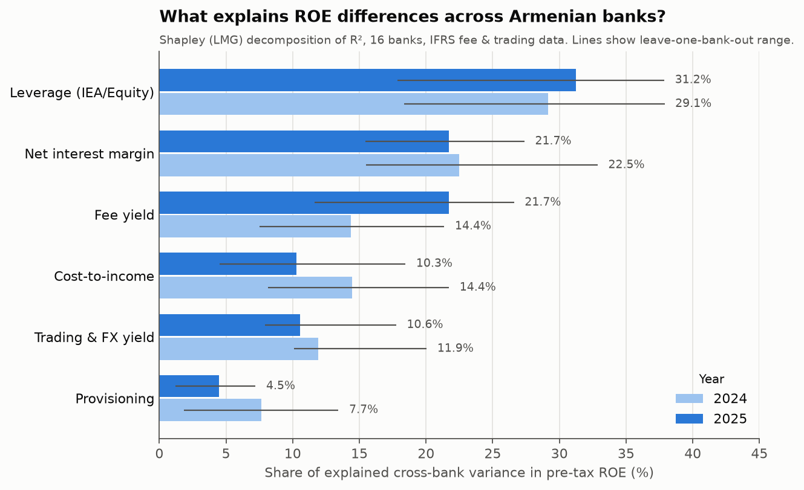
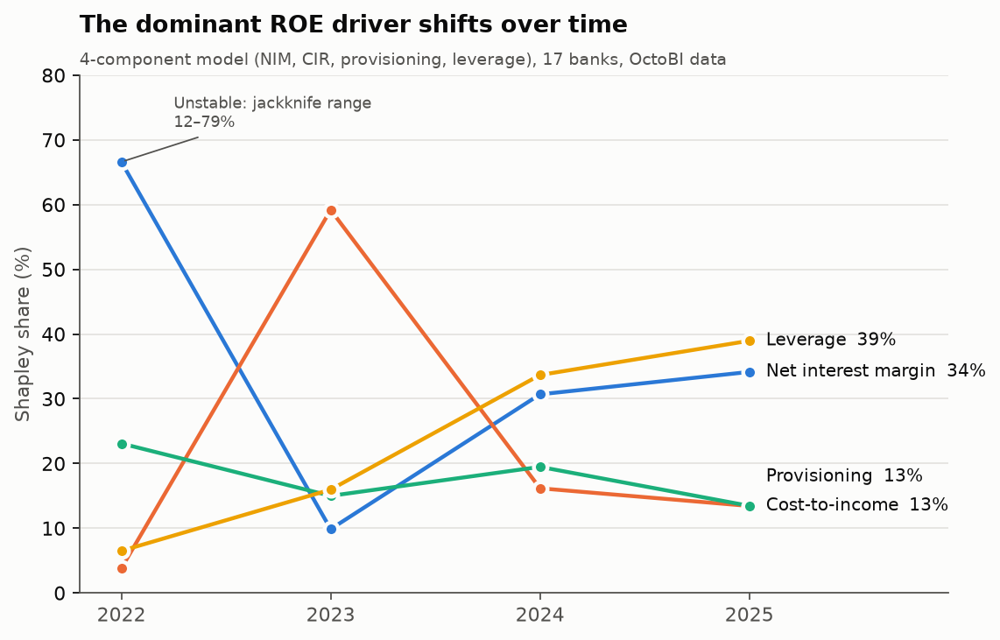
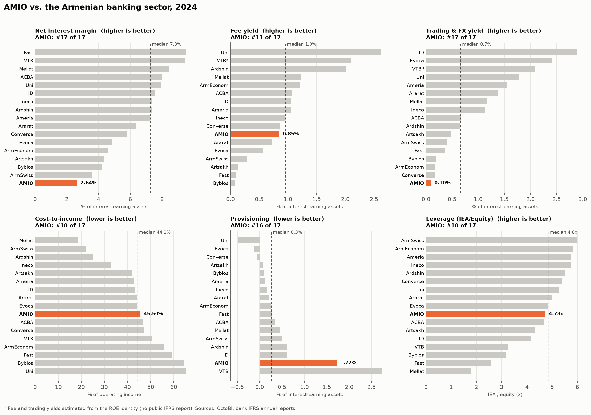

# What drives bank profitability in Armenia?

A Shapley-value decomposition of return on equity (ROE) across Armenian commercial banks, 2022–2025.
I replicate [Melik-Parsadanyan (2026)](#reference), then extend it to the whole sector and to more recent years, and add robustness checks.



## The question

Some Armenian banks earn a 30% ROE and others earn 5%. Is that gap driven by interest margins, fee income, cost efficiency, credit losses, or leverage? Looking at each ratio separately can't answer this, because the drivers interact and are correlated with each other. A Shapley decomposition splits the explained cross-bank variance in ROE among the drivers. The split is order-independent and adds up to the total exactly.

## Approach

**1. A bank-specific ROE identity** (Melik-Parsadanyan 2026, Eq. 4)

```
ROE = [ (NIM + f + x) · (1 − CIR) − γ ] · (A/E) · (1 − t)
```

| Symbol | Driver | Definition |
|---|---|---|
| NIM | Net interest margin | net interest income / interest-earning assets (IEA) |
| f | Fee yield | net fee & commission income / IEA |
| x | Trading & FX yield | net trading and FX income / IEA |
| CIR | Cost-to-income | operating expenses / operating income |
| γ | Provisioning | net loan-impairment charge / IEA |
| A/E | Leverage | IEA / equity |
| t | Tax | effective tax rate |

Unlike a standard DuPont split (margin × asset turnover × leverage), this identity separates the drivers that actually matter for banks: interest margin, non-interest income, cost efficiency and credit cost. All decompositions use **pre-tax** ROE, so differences in tax position don't show up as differences in operating performance.

**2. Shapley (LMG) decomposition of R².** For each year, pre-tax ROE is regressed (OLS) on every one of the 2⁶ = 64 subsets of drivers. Each driver gets its average marginal contribution to R² over all orders in which it can enter the model. The contributions sum to the full-model R² and are reported as shares of it.

**3. Robustness.**
- **Leave-one-bank-out jackknife:** checks whether a finding depends on any single bank.
- **Reconciliation:** checks the identity against reported ROE.
- **R² simulation:** shows why the paper's R² (10 banks) and this project's (16) aren't directly comparable.

## Results

### 1. Replication: matches the paper exactly

On the paper's own Table A1 data (10 banks, 2023), the code reproduces its result: **R² = 99.8%, with cost-to-income the largest driver (49.5%)**. Using each bank's own tax rate, the identity reproduces reported ROE to within 0.03pp.

### 2. 2024–2025: leverage explains the most, then NIM

16 banks, with fee and trading income collected by hand from each bank's IFRS annual report:

| Driver | 2024 | 2025 |
|---|---:|---:|
| **Leverage (IEA/equity)** | **29.1%** | **31.2%** |
| Net interest margin | 22.5% | 21.7% |
| Fee yield | 14.4% | 21.7% |
| Cost-to-income | 14.4% | 10.3% |
| Trading & FX yield | 11.9% | 10.6% |
| Provisioning | 7.7% | 4.5% |
| *Model R²* | *90.8%* | *91.1%* |

Leverage is the largest driver in 14 of 16 leave-one-out runs in each year. Fee income doubles in importance from 2024 to 2025 and ties NIM for second place.

### 3. The dominant driver changes over time



Fee and trading income are not available for 2022–23, so the four-year comparison uses the 4-driver version of the identity (17 banks):

| Year | Largest driver | Share | Jackknife range | Ranked #1 in |
|---|---|---:|---|---:|
| 2022 | NIM | 66.6% | 12–79% | 16 / 17 runs |
| 2023 | Cost-to-income | 59.2% | 49–63% | 17 / 17 |
| 2024 | Leverage | 33.7% | 25–48% | 13 / 17 |
| 2025 | Leverage | 39.0% | 26–46% | 13 / 17 |

The 2022 NIM result depends heavily on a few banks: dropping one of them moves the NIM share anywhere between 12% and 79%. The 2023 cost-efficiency result is robust.

### 4. Case study: AMIO Bank



AMIO's ROE was the lowest in the sector in 2024 (1.7%) and recovered to 8.8% in 2025. Its ranks among 17 banks (1 = best):

| | 2024 | 2025 |
|---|---|---|
| Net interest margin | 2.6% (#17) | 2.9% (#17) |
| Provisioning | 1.72% (#16) | 0.32% (#8) |
| Cost-to-income | 45.5% (#10) | 47.4% (#11) |
| Leverage | 4.73x (#10) | 4.56x (#11) |

AMIO's pre-tax ROE rose 6.9pp. A Shapley attribution of that change across the six drivers gives **+6.5pp to lower provisioning**. All other drivers combined contribute less than ±1pp. The recovery came from credit costs normalizing, not from margins or balance-sheet growth, and AMIO's NIM is still the lowest in the sector. [2025 chart](results/figures/peer_positioning_AMIO_2025.png).

### 5. Diagnostics

- **Reconciliation:** with a flat 18% tax rate, Eq. 4 reproduces reported ROE with a median absolute gap of 1.1pp (1.2pp in 2025). Only four bank-years miss by more than 2.5pp. The largest is Ardshinbank 2024: reported ROE is 53% versus 31% from the identity, so its reported profit includes items the six drivers don't capture, or its effective tax rate is far from 18%.
- **R² vs. sample size:** with 6 drivers plus an intercept, randomly drawn 10-bank subsamples average 96% R², and 8-bank subsamples average 99%. The paper's 99.8% on 10 banks mostly reflects having only 3 residual degrees of freedom.

## Data

| File | Contents | Source |
|---|---|---|
| `data/octobi_ratios_2022_2025.csv` | NIM, CIR, credit cost, assets/equity, IEA/assets, net loans/assets and ROE for 17 banks at year-end 2022–2025 | Derived from an OctoBI analytics-platform export (raw export not redistributed) |
| `data/ifrs_fee_trading_2024_2025.csv` | Net fee & commission and net trading/FX income for 16 banks, 2024–2025 (32 bank-years) | Collected by hand from IFRS annual reports |
| `data/paper_table_a1_2023.csv` | The paper's dataset: 10 banks, 2023 | Melik-Parsadanyan (2026), Table A1 |

Sample choices and data adjustments (HSBC, VTB, Mellat, Converse, Fast Bank) are documented in [`data/README.md`](data/README.md). Methodological caveats are in [`docs/methodology.md`](docs/methodology.md).

## Run it

```bash
pip install -r requirements.txt
python -m roe_shapley            # all analyses -> results/tables/*.csv, results/figures/*.png
python -m roe_shapley ifrs       # a single analysis: replicate | ifrs | trend | reconcile | r2-demo | peers
python -m roe_shapley peers --bank Ineco   # peer positioning for any bank
pytest                           # tests, including replication of the paper's numbers
```

## Project structure

```
roe_shapley/
  shapley.py      Shapley/LMG decomposition of R², jackknife
  components.py   ROE identity, driver construction, back-calculation
  data.py         loading; builds the bank-year panel from a raw OctoBI export
  analyses.py     each analysis -> results/tables/
  charts.py       figures -> results/figures/
  __main__.py     command-line entry point
data/             inputs (see data/README.md)
results/          generated tables and figures
tests/            unit tests and replication checks
docs/             methodology notes
```

Built with Python, pandas, NumPy and matplotlib.

## Reference

Melik-Parsadanyan, V. (2026). Accounting-based assessment of bank ROE: Evidence from Armenian banks. *Banks and Bank Systems.*
